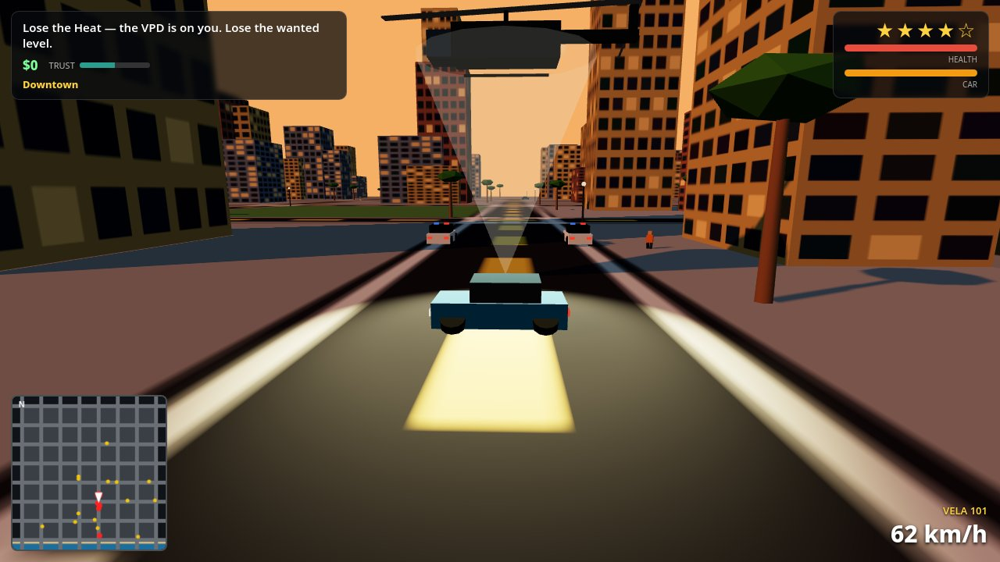

# VELAMAR HEAT — an open-world crime game

[](https://make.fun/bounty/gta6-01?utm_source=github&utm_medium=readme&utm_campaign=gta6-01)
[](https://make.fun/bounty/gta6-01/leaderboard?utm_source=github&utm_medium=readme&utm_campaign=gta6-01)
[](https://make.fun/bounty/gta6-01?utm_source=github&utm_medium=readme&utm_campaign=gta6-01)



Sun, salt and stolen cars. **Milo Reyes** owes the Marín family a fortune, and the
only way out is one last score across **Velamar** — a sun-soaked coastal city you
explore on foot and by car. Ten story missions, two heists, and every cop in
the city. Steal cars, lose the heat, and choose how the story ends.

## What is in the game

- **A city to explore** — 49 blocks of procedural Velamar: a marina, docks, harbor,
  beach and ocean, traffic, crossing pedestrians, palms and golden-hour sun.
- **On foot and by car** — walk, run, jump, punch, shoot; steal any parked car and
  drive it with arcade handling. Three radio stations play while you drive.
- **Wanted level** — five stars of VPD pursuit: cruisers that chase and ram, a
  second wave on long chases, roadblocks and spike strips at three stars and up,
  and a police helicopter with a searchlight at four stars and up.
- **Missions and a story** — ten story missions (including two heists, a street
  race, an informant pickup and a hot collection run), a TRUST meter with Ana
  that changes the final job, three endings, and repeatable taxi
  and courier side jobs after the story.
- **Garage upgrades** — at the Auto Shop, in your car: Engine (+8 top speed per
  level, max 2), Armor (+50 max car health per level, max 2) and NOS (hold Shift
  to boost, refillable). Upgrades stay with the car you tuned.
- **Two guns** — the pistol by the spawn, plus an SMG crate at the Docks. Press Q
  on foot to switch; the SMG fires faster with lighter hits, sharing one ammo pool.
- **HUD with a minimap** — wanted stars, health, car condition, NOS charge, money, TRUST,
  the district you are standing in, your weapon and ammo, mission objective with
  a live beacon, and a top-down map of the city (the helicopter shows up on it too).
- **A start screen and a save** — progress autosaves after every mission and can
  be saved from the pause menu; Continue picks it back up.
- **Sound, all synthesized** — engine hum, sirens, gunshots, mission jingles and
  three generative radio stations. No audio files.

## Controls

| Key | Action |
| --- | --- |
| W A S D | Move / drive |
| Mouse | Look around (click to lock) |
| Shift | Run / NOS boost while driving |
| Space | Jump |
| E | Get in / out of a car, grab, rob (hold), repair at the Auto Shop |
| Click | Shoot (hold to keep firing) |
| Q | Switch Pistol / SMG on foot |
| 1 / 2 / 3 | Garage upgrades at the Auto Shop (Engine / Armor / NOS) |
| F | Punch |
| R | Change radio station |
| M | Mute |
| Esc | Pause / save |

## Play it

Serve `game/` with any static server and open `game/index.html` in desktop
Chrome. For example, from this repository:

```sh
node serve.ts   # serves game/ at http://localhost:8080
```

No build step, no network request: every file the game loads lives under
`game/`. The screenshots in `screenshots/` are real renders of the game.

## Tech

- Three.js (r160, vendored under `game/vendor/`, MIT) for the 3D city.
- Everything else is hand-written: the city generator, traffic and pedestrian
  AI, police pursuit, missions, radio and HUD are the game's own source under
  `game/src/`, one file per system.
- `main.ts` (Node 22) hands the entry in: it copies `game/` and `screenshots/`
  to `/output` and writes `/output/dossier.json` with the vendored make.fun
  library (`vendor/makefun-game.ts`).

## License

MIT — see `LICENSE`. Three.js is © Three.js Authors, MIT.
